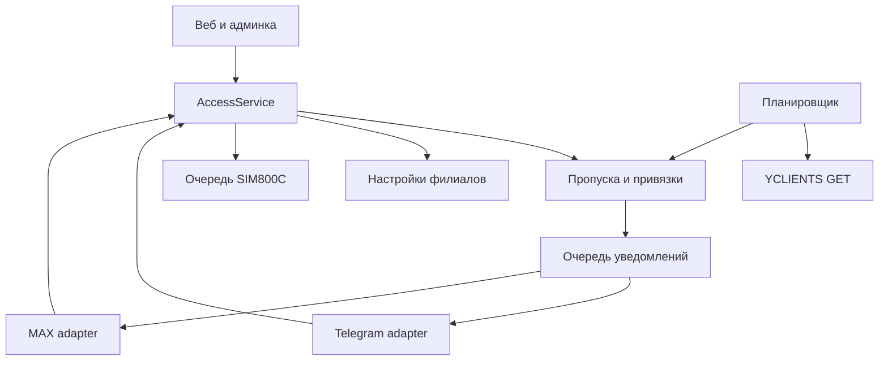

# Архитектура и модель данных

## Направление зависимостей

`run.py` — единственная штатная точка запуска. Он владеет процессной блокировкой, HTTP-сервером Waitress, polling обоих ботов, планировщиком и доставкой уведомлений. Импорт модулей не запускает интеграции. `app.py` определяет только веб-приложение.

## Модули

| Область | Модули | Ответственность |
|---|---|---|
| Авторизация проезда | `access_service.py` | Проверка пропуска, филиала, кнопки и интервала между командами |
| Пользователи/пропуска | `link_manager.py` | CRUD, ручная блокировка, автоматические права, привязки мессенджеров |
| Филиалы | `branch_manager.py` | Валидированная конфигурация, стабильные непрозрачные ID кнопок |
| Веб/роли | `app.py`, `admin_auth.py` | HTTP, CSRF, актуальные роли, сессии, область данных администратора |
| CRM | `yclients_api.py`, `scheduler.py` | Разрешённые GET, полный снимок записей, ветвление по филиалам |
| MAX | `max_api.py`, `max_bot.py` | Собственный контракт MAX, подписанный контакт, marker polling |
| Telegram | `telegram_bot.py` | Контакт Telegram, callbacks, lifecycle PTB |
| Идемпотентность | `bot_state.py`, `runtime_state.py` | Callback claims, checkpoints, cooldown, outbox |
| Железо | `sim800c.py`, `sms_pdu.py` | Один владелец порта, очередь, AT, PDU/UCS2/UDH |
| Поддержка | `logger.py`, `diagnostics.py`, `manage.py` | События, фильтрация, версия, диагностическая выгрузка |

## Филиал как граница данных

`branch_id` соответствует `company_id` YCLIENTS. В текущем этапе нет отдельной сущности платящего юридического лица поверх нескольких филиалов. Её добавление необходимо перед биллингом; заранее объединять филиалы по телефону клиента или по одинаковому CRM ID нельзя.

У обычного администратора один филиал. Его роль и область повторно читаются из приватного хранилища на каждом запросе. Отсутствующий филиал закрывает доступ. Суперадминистратор определяется явным `is_super=true`, а не отсутствием `branch_id`.

## Хранение

Бизнес-данные сохраняют совместимость с исходным форматом:

- `data/branches.json` — филиалы, кнопки, часовые пояса и имена переменных окружения для CRM credentials;
- `data/links.json` — персональные токены, клиенты, пропуска и подтверждённые связи с ботами;
- `data/admins.json` — администраторы, хеши паролей и область доступа;
- `data/session.key` — локальный development secret; в production используется `SECRET_KEY`;
- `data/runtime.sqlite3` — cooldown и outbox уведомлений;
- `data/bot_state.sqlite3` — markers и claims мессенджеров;
- `data/logs/events.jsonl` — структурированный журнал с ротацией.

Каждое изменение JSON выполняется под межпроцессной файловой блокировкой как полная транзакция read/modify/write, с записью временного файла, `fsync` и атомарным `replace`. Повреждённый JSON не заменяется пустым хранилищем. `save_links`/`save_branches` — только целиком подготовленный импорт; обычный код использует методы мутаций.

Это переходный формат первого этапа. Он защищает текущий единичный runtime от потерянных обновлений, но не заменяет транзакционную модель промышленной системы: бизнес-запись и outbox ещё не находятся в одной транзакции. Перенос бизнес-сущностей в SQLite/PostgreSQL с миграциями и transactional outbox является отдельным обязательным этапом перед коммерческим масштабированием. Несколько контейнеров с общими JSON-файлами не поддерживаются.

## Пропуск

Основные поля: `branch_id`, `id_ycl`, `user_name`, `phone`, `email`, `tg_id`, `max_id`, `gate_access`, `access_expires`, `access_source`, `admin_blocked`, `mailing_enabled`, `is_temporary`, `access_revision`, `created`.

`access_source=manual` сохраняет ручные права; `appointment` принадлежит CRM-планировщику. `admin_blocked` имеет высший приоритет. `mailing_enabled` не используется как условие проезда. Любая проверка времени использует aware datetime; старые naive даты трактуются в настроенной локальной зоне.

Телефон нормализуется для сравнения, но сам по себе не доказывает личность. Клиентский токен содержит 128 бит случайности; старые токены не перегенерируются автоматически. Кнопка имеет короткий HMAC ID, изменяющийся при изменении её номера или типа. Клиент не получает телефон ворот.

## Порядок блокировок

При открытии: конфигурация филиалов → пропуска → runtime SQLite → быстрая постановка в очередь модема. Роль и параметры ворот нельзя поменять между финальной проверкой и приёмом команды. Один сериализованный владелец COM исполняет звонки и читает SMS; обработчики HTTP и ботов не пишут AT-команды сами.

Callbacks заявляются в durable state до физического эффекта. Это модель at-most-once: при аварии между claim и выполнением команда может не исполниться, но не будет автоматически повторена и неожиданно откроет ворота позднее. Пользователь может сделать новое осознанное нажатие после проверки ситуации.

## Границы готовности

Приём команд не является датчиком открытия. Polling в этой версии предназначен для локальной разработки. MAX production должен перейти на проверенный webhook ingress и очередь. Модель нескольких серверов, общий Redis, HA, оплаты и EXOLVE здесь не подразумеваются и не включены автоматически.
