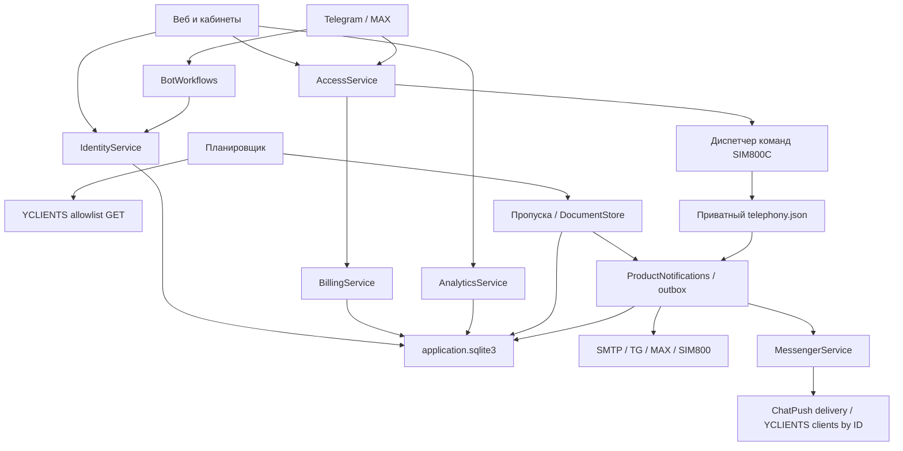

# Архитектура и модель данных

Текущая реализация `0.2.0-alpha.21`, 21.11.2026. Проектные решения и история перехода — [NEXT_STAGE_PLAN.md](NEXT_STAGE_PLAN.md); порядок запуска и восстановления — [OPERATIONS.md](OPERATIONS.md). Локальная миграция принята отдельно; внешние интеграции и production не считаются проверенными офлайн-тестами.

## Направление зависимостей

Уведомления о пропусках используют общий критерий `pass_notifications.timely_grant`. Для каждой подходящей записи YCLIENTS планировщик хранит длительность услуги в секундах и рассчитывает последний момент отправки. При нескольких визитах берёт наиболее позднюю подходящую отсечку. Для доступа используется `pass_duration_hours` филиала, по умолчанию восемь часов от начала визита. Выборка записей захватывает предыдущие даты, если такой пропуск ещё действует. Диспетчер повторно проверяет актуальную карточку при доставке, исполнитель SMS также проверяет её перед передачей в модем.

`run.py` владеет единственным runtime-lock, миграцией, Waitress, polling ботов, планировщиком, доставкой, монитором SIM800 и закрытием подключений. Импорт приложения не запускает сеть, COM или worker. `ApplicationServices` собирает сервисы и связывает текущие managers с общей БД; Flask blueprints получают их через provider, чтобы изменение роли/состояния не оставляло прежний scope в замыкании.

## Модули

| Область | Модули | Ответственность |
|---|---|---|
| Авторизация проезда | `access_service.py` | Пропуск, блокировка, филиал, маршрут, общий cooldown, допуск и повторная проверка перед исполнением |
| Совместимость клиентов/филиалов | `link_manager.py`, `branch_manager.py` | Прежние токены/CRUD/ручные и CRM-права; стабильный ID ворот и изменяемый ID маршрута |
| SQL и миграция | `storage/product_store.py`, `storage/sql_documents.py` | SQLite WAL/FK, вложенные savepoints, импорт и документная совместимость без dual-write |
| Личности и роли | `identity_service.py`, `admin_auth.py`, `admin.py` | Люди, аккаунты, memberships, super-role, пароль/сессии, приглашения/OTP, уровни привязки |
| Жизненный цикл филиала | `branch_lifecycle.py` | Предпросмотр, super-only подтверждение ID/ревизии, атомарное удаление прикладных данных филиала, защита общих личностей и текущих эффектов |
| Рабочие часы | `branch_hours.py` | Недельные интервалы в часовом поясе филиала, scoped настройки, независимое ограничение допуска до очереди и перед исполнением |
| Клиентские каналы из таблицы | `client_notification_admin.py`, `static/js/client-notification-admin.js` | Scope чтения/сохранения/подключения, эффективный статус, окно каналов, сохранение проверки административной почты |
| Восстановление | `password_recovery.py`, `password_recovery_web.py` | SMS challenge, ограниченный reset-token без админ-сессии, отзыв старых сессий/повышений |
| Помощь и поддержка | `help_catalog.py`, `help_support_web.py`, `support_service.py` | Каталог, личные обращения, приватная очередь к ботам супера, ответы из BotWorkflows |
| Палитра | `palette_settings.py`, `palette_web.py`, `palette_catalog.py`, `scripts/build_palette.py` | Полный каталог CSS-цветов, super-only настройки, версии, публичный безопасный stylesheet |
| Системная конфигурация | `system_config_bootstrap.py`, `system_settings_catalog.py`, `system_settings.py`, `system_settings_web.py` | Зашифрованные параметры до загрузки config; супер, типизированные поля, источник/ожидание перезапуска, общая форма SMTP |
| Веб | `app.py`, `identity_web.py`, `product_web.py` | CSRF, актуальный scope, public/admin формы и API |
| Подписки | `billing_service.py` | Периоды, квота/резервы/ledger, идемпотентный допуск, подарки, заказы и напоминания |
| Аналитика | `analytics_service.py` | Проверяемые фильтры, группировки/нулевые интервалы/зоны, сравнение, CSV |
| Сообщения | `product_notifications.py`, `application_services.py` | Общая outbox, перепроверка получателя, inbox, мост событий телефонии, reconciliation |
| Сервис рассылки филиала | `messenger_service.py`, `messenger_web.py`, `yclients_delivery.py` | Логический канал messengers; серверный выбор ChatPush/YCLIENTS, получатель по телефону/CRM ID, фиксированный отправляющий endpoint отдельно от reader |
| Тестовая отправка интеграций | `integration_test_delivery.py`, `messenger_web.py`, `static/js/integration-test.js` | Явный выбор транспорта и одного получателя; область филиала, серверный CRM ID, защита повторов, результат без обещания доставки |
| CRM | `yclients_api.py`, `scheduler.py`, `yclients_connection.py` | GET-only reader; отдельный вход/2FA обычного пользователя, профиль, проверка прав; только сохранённые credentials конкретного филиала |
| Связь клиентов с CRM | `yclients_client_sync.py`, `yclients_client_sync_jobs.py`, `yclients_client_sync_web.py` | Точный телефон в пределах филиала, безопасное обновление ID, постоянная очередь и массовое обновление; без изменения пропуска, роли или рассылки |
| Маркетплейс YCLIENTS | `yclients_marketplace.py`, `yclients_marketplace_web.py` | Часовой browser-bound redirect, HMAC профиля, автоматический CSRF POST, проверка пользователя филиала, атомарная регистрация, GET-сверка, lifecycle callback; установка выключена по умолчанию |
| Почта | `smtp_settings.py`, `smtp_web.py`, `smtp_mailing.py` | Общая шифрованная конфигурация только супера; TLS/STARTTLS и проверка соединения без письма |
| ChatPush | `chatpush.py`, формы интеграций в `identity_web.py` | Один зашифрованный токен на филиал; POST `api.chatpush.ru/api/v1/delivery` только с `phone`/`text` и сырым токеном в `authorization`; accepted не равен доставке |
| Мессенджеры | `telegram_bot.py`, `max_api.py`, `max_bot.py`, `bot_workflows.py`, `bot_menu.py` | Независимые transports, scoped admin workflows, обновление одного меню |
| Checkpoints | `bot_state.py`, `runtime_state.py` | Claims/cursors/menu/dialog state, совместимость cooldown/outbox прежней версии |
| Железо/телефония | `sim800c.py`, `sms_pdu.py`, `sms_submit.py`, `telephony_service.py`, `telephony_store.py` | Один reader/queue, AT/PDU/UCS2/UDH, приватный журнал и ручные операции супера |
| UI | `templates/base.html`, `templates/components/header.html`, `static/css/ui.css`, `static/js/ui.js` | Одна шапка, бренд, общие компоненты; page CSS/JS не заменяют роли сервера |

## Филиалы, люди и роли

Граница операционных данных и подписки — неизменный `branch_id`. У прежних филиалов он соответствует company_id YCLIENTS; самостоятельные филиалы получают серверный числовой ID из SQLite-последовательности от `10^12`, с проверкой существующих и ожидающих регистрацию ID. Общая организация/плательщик поверх нескольких филиалов пока не вводится. Одинаковый CRM ID в разных филиалах не объединяет права. `yclients_enabled` по умолчанию равен true для старых документов; false отключает CRM-планировщик и запрещает YCLIENTS/ChatPush на серверной границе. `id_origin=internal` не допускает использования внутреннего ID как company_id.

`persons` хранит личность и подтверждённые контакты; `branch_clients` — принадлежность клиента филиалу и прежний токен; `web_accounts` связывает логин с человеком. Новые аккаунты используют email как логин. В одном филиале возможно несколько администраторов, но обычный администратор имеет только один основной `admins.branch_id`. Исторические дополнительные memberships остаются в БД, не расширяя scope и основание `admin_role_active`. `system_roles` фиксирует superadmin со всеми филиалами. Сервер пересчитывает scope каждого чтения, CSV, уведомления и мутации; переключение контекста не создаёт прав. Подробнее — [ACCOUNTS.md](ACCOUNTS.md).

Обычная привязка клиентского токена обеспечивает только клиентский доступ. Для административного меню бота нужна отдельная одноразовая ссылка из авторизованного кабинета и binding `assurance=admin_verified`. Отзыв роли, изменение пароля/сессии или чужая ссылка не повышают права. `admin_role` создаёт отдельное постоянное основание пропуска; снятие роли сохраняет независимые клиентские права.

Роль в таблице вычисляет `IdentityService.client_admin_state`, а не исторический клиентский флаг. Отзыв и удаление клиента-администратора проверяют актуальную роль и число действующих администраторов в одной транзакции. Для удаления требуется явное подтверждение отзыва; изменение версии сессии закрывает прежний административный доступ. Последнего администратора не может удалить или отозвать даже супер, глобальная super-role не считается дополнительным филиальным назначением. Клиентский API не удаляет глобальную роль супера. [ADMIN_CLIENT_LIFECYCLE](ADMIN_CLIENT_LIFECYCLE.md).

Штатный импорт очищает устаревший клиентский индекс и восстанавливает одну отсутствующую карточку действующего администратора своего основного филиала с новым токеном. Хеш пароля и роль не меняются; явный `admin_blocked` существующей карточки сохраняется. Отозванные роли, удалённые филиалы и копии супера во всех филиалах не создаются. `pending_verification` остаётся выключенным до решения супера: собственный пропуск и доступность филиала сериализуются отдельно, чтобы таблица не называла постоянный пропуск запрещённым из-за состояния филиала.

Административный email разрешается общим `IdentityService._admin_contact`: собственная SQL-личность → клиент основного филиала (для супера — его основная или первая карточка). Один адрес используется UI, получателями событий, приветствием и повторной проверкой outbox. Валидный профильный адрес делает канал доступным без обязательной email-верификации; login и `persons.email_verified` не подменяются. Изменение из карточки и верхнего блока уведомлений записывает один контакт; публичный bearer не может менять административный email без веб-авторизации, обычный администратор не может перенаправить почту супера. CRM сохраняет адрес активной административной роли.

Приглашения и registration tokens имеют срок и состояние; в БД хранятся хеши. Принятие с OTP выполняется транзакционно: проверка телефона, полномочий пригласившего, аккаунта/филиала, потребление challenge и назначение роли. GET превью-ссылки не потребляет приглашение. OTP имеет HMAC, TTL, лимиты попыток и отправки. По явному требованию владельца текст всех исходящих SMS, включая OTP, сохраняется в приватном `telephony.json`, доступном только суперу; SQL-проверка кода использует HMAC, общий audit и public queue status текста не содержат. После проверки SMS и сохранения пароля `IdentityService` атомарно активирует филиал, роль и первый trial при ручной регистрации с YCLIENTS или без CRM. При старте миграция активирует только `pending_verification` в режиме `direct` с завершённой регистрацией YCLIENTS. Использованный пробный срок, история подписки и приостановки учитываются перед выдачей trial. Пустые маршруты создаются с `hardware_routes_verified=false`, но администратор своего филиала может настроить/изменить их сам; успешное сохранение ворот снимает этот старый маркер.

## Хранение и переход с JSON

`storage.sql_documents.migrate_legacy(data_dir, activate=False)` строит предварительный отчёт с количествами. Штатный `run.py` вызывает активацию под runtime-lock до запуска workers. В приватном каталоге сохраняются копии трёх исходных JSON и манифест хешей; маркер `.sql-active` появляется только после durable SQL commit. Повтор активированного импорта не затирает новые данные.

После активации `DocumentStore` читает/меняет документы `branches.json`, `links.json`, `admins.json` внутри `application.sqlite3`. Это явный слой совместимости: филиалы и старые поля пропуска пока представлены SQL-документами, а новые личности, роли, подписки и события — отдельными таблицами. Прежние JSON не записываются параллельно с SQL. Старые персональные токены, хеши паролей, даты и ручные блокировки сохраняются; отсутствующие телефоны остаются в отчёте, не угадываются.

| Файл | Содержимое / назначение |
|---|---|
| `application.sqlite3` | Документы совместимости; persons/branch_clients/accounts/memberships/bindings; приглашения, OTP, tickets, настройки; подписки/ledger/requests/commands/events; outbox/inbox и подключения |
| `telephony.json` | Приватные номера, звонки, SMS, части и наблюдения; требуемый отдельный JSON, только супер; не входит в support bundle |
| `bot_state.sqlite3` | Polling cursors, callback claims, state диалогов и меню |
| `runtime.sqlite3` | Прежний runtime state и outbox; совместимость/идемпотентный перенос уведомлений |
| `integration.key` | Серверный ключ шифрования credentials/outbox, отдельно от БД; нужен для восстановления |
| `session.key` | Локальный development secret; в production нужен `SECRET_KEY` |
| `migration-backups/` | Приватный исходный снимок и хеш-манифест миграции |
| `logs/events.jsonl` | Диагностический журнал с ротацией, не источник биллинга/статистики |
| `private/system-config/settings.enc` и `settings.key` в корне проекта | Зашифрованные системные параметры и отдельный ключ, постоянный путь вне изменяемого DATA_DIR |

`ProductStore` использует WAL, `foreign_keys=ON`, `synchronous=FULL`, `BEGIN IMMEDIATE`; вложенные операции в той же БД разделяют connection и savepoints. Изменение SQL-документа, доменного состояния и outbox может участвовать в одном commit. В legacy-режиме используется один экземпляр файловой блокировки JsonStore: вложенное чтение не должно брать второй независимый lock того же Windows-файла.

Резервировать нужно согласованное состояние БД и ключи, а не только прежние JSON. После новых команд/сообщений восстановление старого JSON не является корректным откатом: будут потеряны ledger, outbox и неизвестные результаты. Несколько runtime с одной БД/модемом и HA здесь не поддерживаются.

`storage.config` загружает `.env`, затем `system_config_bootstrap` применяет сохранённые параметры до вычисления производных значений и до запуска runtime. Изменения из super-only `/admin/system-settings` атомарно сохраняются в зашифрованный файл под блокировкой, с проверкой revision. API различает сохранённое и активное состояние; секреты не возвращаются. До перезапуска порт, сессии, боты и COM используют текущую конфигурацию. Повреждение или отсутствие ключа останавливают загрузку с безопасной ошибкой. Изменение DATA_DIR не переносит данные; SECRET_KEY завершает старые сессии после перезапуска. Файлы bootstrap и их парный ключ нужно сохранять при пересоздании контейнера отдельно от `/state`; подробности — [SYSTEM_SETTINGS](SYSTEM_SETTINGS.md).

## Пропуск, маршрут и команда

Сохраняются `branch_id`, `id_ycl`, имя/телефон/email, отдельные `tg_id`/`max_id`, `gate_access`, `access_expires`, `access_source`, `admin_blocked`, `mailing_enabled`, `access_revision`, `created`. Aware datetime учитывает часовой пояс; старые naive даты трактуются в локальной зоне. Телефон обязателен для новых клиентов, но сам по себе не является доказательством владения.

Приоритет: явная блокировка → пригодность филиала/подписки → действующие ручные/CRM/административные основания; недельное расписание дополнительно ограничивает время фактического проезда для всех оснований. Отписка не блокирует ворота. Долгоживущий `stable_id` ворот служит аналитике и объединению команд; ID маршрута меняется при изменении номера/типа. Старый callback не начинает звонить на новый номер. Клиент вообще не передаёт номер ворот.

Последовательность: серверный scope и токен/binding → актуальные филиал/пропуск/маршрут → транзакционный допуск/квота/cooldown → единственная hardware queue → повторная проверка перед исполнением → фиксация начала физической попытки → терминальный результат. Общий cooldown 20 секунд действует между web и ботами для человека/филиала. Повторы request_id не создают новую команду. Объединение ограничено филиалом и стабильными воротами, не одним телефонным номером.

`branch_hours` оценивает `access_schedule` по текущему времени филиала, включая ночные интервалы и границы недели. Отсутствие ограничения сохраняет 24/7, некорректное сохранённое расписание закрывает допуск. Проверка выполняется в `AccessService` при запросе и непосредственно перед физической попыткой; изменение часов не меняет ни пропуска, ни уведомления. Веб показывает закрытие в начальном HTML и выключает кнопки, QR отклоняет вход и OTP до запроса телефона, боты возвращают сообщение о рабочих часах и контакте администратора. Запомненный QR-клиент не получает обхода. [BRANCH_HOURS](BRANCH_HOURS.md).

Удаление целого филиала идёт через `BranchLifecycleService` после super-only предпросмотра и проверки ревизии. Это отдельное исключение из защиты последнего администратора. В транзакции удаляются филиал и все привязанные прикладные записи, включая аккаунты филиальных администраторов, каналы/подключения, приглашения, QR, CRM-расписание, сообщения, поддержку, аналитику и биллинг; логотип удаляется после commit. Общая личность с клиентами другого филиала, глобальный супер, общие настройки, архив телефонии, журналы и backups сохраняются. Операция не выполняет запросов записи в CRM и блокируется при текущих командах/отправках. Устаревший снимок CRM не восстанавливает удалённый филиал.

Резерв занятой квоты создаётся атомарно; последняя доступная единица не выдаётся двум конкурирующим запросам. До физической попытки отмена освобождает резерв. После начала ATD неизвестный результат не повторяется автоматически и не выдаётся за отсутствие эффекта. `queued`, `started`, `command_sent`, `failed`, `unknown`, `cancelled`, `expired`, `simulated` различаются. Положение ворот не измеряется: `confirmed=false` сохраняет этот смысл.

## Подписки и аналитика

`billing_catalog/revisions` хранит тарифы и пакеты, `billing_offers` — версии приватной PDF-оферты. `billing_accounts/terms/periods`, `billing_term_details`, `billing_package_grants`, `billing_renewals/consents/renewal_intents` содержат выданные снимки условий, периоды и согласия. Суммы — целые копейки. Новый период совпадает с полным сроком тарифа; старые месячные периоды и их расход не переписываются. Пробный тариф находится в каталоге, выдаётся один раз и по умолчанию имеет срок два календарных месяца без квот.

Звонки используют `quota_ledger`, `gate_requests`, `hardware_commands`, снимки адресата в `billing_request_details`. SMS используют `sms_billing_commands` и `sms_quota_ledger`, резервируют количество частей до отправки и идемпотентно фиксируют принятые/неопределённые части. Регистрационные SMS имеют явное серверное исключение. Флаг филиала и отдельное согласие клиента контролируют SMS-уведомления; служебные сообщения имеют другое назначение. Оба леджера защищены от UPDATE/DELETE, кроме атомарного удаления всего филиала с восстановлением триггеров.

Заказы и платежи разделены. Checkout остаётся заглушкой; `apply_payment` не опубликован как ручной HTTP endpoint. Для супера в development предусмотрена отдельная тестовая активация: `billing_test_activations` хранит идемпотентность, период помечается `source=test`, банковского платежа и согласий не возникает. Отмена увеличивает ревизию согласия, которую проверяет обработка позднего события. Отменённые периоды исключены из расчёта следующего подключения. Подготовленное намерение продления не выполняет оплату и не создаёт оплаченный доступ. PDF, согласованная цена и квоты сохраняются в снимке; новая редакция каталога не меняет прошлый период. Детали — [BILLING.md](BILLING.md).

`AnalyticsService` принимает проверяемый набор фильтров, а не SQL от браузера, и всегда пересекает доступные филиалы. Тип пропуска фиксируется на момент события; клиенты, время, каналы, результат и стабильные ворота позволяют независимые группировки/CSV. Частота делится на полную длительность выбранного интервала. Старую историю не изобретают; начало достоверного покрытия показывается отдельно.

## Уведомления и внешние подключения

`message_outbox` хранит отдельное задание получатель/канал/событие, зашифрованный payload и устойчивый ключ; `message_effects` — факт попытки внешнего эффекта. Перед delivery проверяются актуальные роль, адресат/binding, согласие и revision пропуска. `sending` после аварии не становится автоматическим повтором. Старый outbox переносится через dedupe bridge. `notification_inbox` хранит пользовательские события независимо от внешних каналов.

Телефония сначала коммитит JSON. `bridge_telephony` сверяет устойчивые ID с SQL и формирует только разрешённые супер-уведомления; разрыв между двумя хранилищами восстанавливается повторной сверкой. Длинные тексты проходят transport-specific разделение. Клиенты не получают служебные напоминания оплаты/квоты.

CRM reader остаётся allowlist GET. Режим `yclients_connection_mode` разделяет «Учётную запись YCLIENTS» и «Приложение YCLIENTS Marketplace». `yclients_connection.py` выполняет явно вызванный вход/2FA, сохраняет разрешённые поля профиля из ответа авторизации, шифрует токен конкретного филиала и не сохраняет пароль. Проверка связи выполняет GET. Marketplace использует серверный контекст регистрации без ручного ID/входа YCLIENTS; ручная авторизация для этого режима запрещена и UI, и backend. Ни `YC_USER_TOKEN`, ни `YC_COMPANY_ID`, ни динамические env-ссылки больше не подставляют обычный пользовательский токен. Общими остаются partner token и системный токен приложения Marketplace, который используется только для подтверждённой установки.

Marketplace проверяет HMAC исходных байтов `user_data`, убирает эти параметры из URL и связывает часовой контекст с браузером. Подписанный `salon_id` сверяется с выбранным филиалом. Если передан ID пользователя, он сверяется с ID установщика в Marketplace. Список пользователей филиала для регистрации не запрашивается. Страница запускает установку защищённым CSRF POST. После подтверждения активной установки пользователь может изменить название филиала, имя, email и телефон. Для локальной регистрации требуются пароль и проверка итогового номера по SMS. При замене валидного подписанного номера проверяется также владение исходным номером. Одна транзакция потребляет подтверждения, создаёт филиал, роль, клиентскую карточку, подключение и первый trial. Стабильный идентификатор установщика сохраняет связь при последующих подключениях даже после правки контактов. У существующего администратора сохраняется пароль и один основной филиал. Временная ошибка требует повторной проверки установки, а номер поколения защищает от результата, пришедшего после отключения. [YCLIENTS Marketplace](YCLIENTS_MARKETPLACE.md).

Встраивание разрешено для GET страниц входа в Marketplace и формы регистрации на `https://yclients.ru` и его HTTPS-поддоменах. У формы собственная Secure Partitioned cookie на `/yclients/marketplace` с `SameSite=None`. При переходе в отдельную вкладку одноразовая ссылка переносит подписанные данные в новый контекст. OTP и полномочия администратора привязаны к своему контексту. Кабинет открывается в отдельной вкладке.

`branch_registered` попадает во входящие суперадминистратора при завершении регистрации через ручную форму или Marketplace. Подтверждённое отключение активной установки создаёт `marketplace_disconnected` для администраторов филиала и супера. Внешние доставки зависят от выбранных для события каналов Email, Telegram Bot и MAX Bot. Настройки существующих аккаунтов сохраняются.

Для ChatPush достаточно токена существующего аккаунта, без scope, provisioning и QR/Telegram authorization. Сохранение не выполняет внешних запросов. Ключи/токены не возвращаются браузеру; старые дополнительные поля зашифрованной конфигурации игнорируются. `MessengerService` выбирает физический транспорт для логического клиентского канала `messengers`: `auto` предпочитает подключённый ChatPush, иначе YCLIENTS; явный выбор сохраняется. В outbox остаётся конкретный транспорт и получатель. Перед отправкой проверяются актуальные филиал, согласие, пропуск, провайдер и адресат; смена не перенаправляет старое задание.

`yclients_delivery.py` использует только POST `sms/clients/by_id/{company_id}` с одним серверным `client_ids` и текстом. Пользовательский токен берётся из encrypted credentials филиала. Телефон не заменяет отсутствующий CRM ID; гость без него через этот транспорт не отправляется. Требуются OUTBOUND_ENABLED и YCLIENTS_ENABLED; неопределённый эффект не повторяется вслепую, принятие не означает доставку. Auth/install/delivery — отдельные явно вызванные продуктовые потоки, они не расширяют GET-reader и не разрешают агенту/тестам реальные изменения CRM. Все проверки используют подменённые transports. [MESSENGER_DELIVERY](MESSENGER_DELIVERY.md).

`IntegrationTestDelivery` обслуживает отдельный явный запрос администратора из «Интеграций». GET `/admin/api/integration-test` читает локальный статус и список допустимых клиентов; POST проверяет роль и основной филиал, доступность выбранного сервиса, текст и одного получателя. Для ChatPush разрешён ручной телефон либо локальный клиент; для YCLIENTS браузер передаёт только токен клиента, а положительный CRM ID берётся сервером. Тест не меняет `messenger_provider`, предпочтения клиента или пропуск. `integration_test_requests` связывает ключ повтора с администратором и содержимым запроса; `ProductNotifications.send` учитывает внешний эффект и передаёт явный тест выбранному транспорту. Повтор при неизвестном исходе не выполняет вторую отправку. На время отправки действуют обычные защиты удаления филиала; его удаление очищает привязанные тестовые запросы. Секреты и сырые ответы провайдера не возвращаются в браузер.

Маркетплейс YCLIENTS использует отдельный install API, а не auth POST. В SQLite намерение связано с браузером, действует час; профиль зашифрован и не доказывает права на неподписанный ID филиала. Перед каждой установкой проверяются актуальная роль и состояние филиала. Попытка фиксируется до запроса; при неопределённом результате доступна только GET-сверка. `uninstall`/`freeze` проверяют ключ партнёра и ID приложения, прекращают чтение CRM без удаления ручных прав/подписки. Проверка поколения защищает от восстановления credentials завершившейся параллельно установкой. Реальные подключения по умолчанию выключены; [настройка и ограничения](YCLIENTS_MARKETPLACE.md).

SMTP — глобальная зашифрованная запись `application_settings.smtp` с `.env` fallback до первого сохранения. И страницы, и сервис перепроверяют super-role; обычные админы не читают сервер/пароль. Системные настройки и прежняя страница SMTP используют одну форму и один сервис, второго writer нет. Новые SMTP-настройки применяются без перезапуска. Проверка выполняет TLS/login/NOOP, письмо не отправляет. [Настройка и резервное копирование](SMTP.md).

OTP-форма использует серверный остаток 60-секундного интервала и HTTP 429/Retry-After. Полная перезагрузка очищает поля/контекст, но не серверные ограничения отправки. Поля редактируются после SMS; изменение связанных данных аннулирует старый контекст, поздние ответы его не восстанавливают. Текст кода помещается в одну UCS2-часть. Приём сетью и доставка на телефон различаются. Приветственное письмо нового аккаунта ставится в зашифрованный outbox в той же транзакции; до настройки SMTP остаётся pending. Оно не содержит секретных ссылок или кода.

Расписание YCLIENTS на сегодня/завтра сохраняется отдельно от сетевого worker. При запуске runtime кеш помечается неактивным до свежего чтения; первый опрос начинается сразу. Каждый цикл заново читает оба дня и принудительно сверяет права, восстанавливая пропущенную выдачу для подходящего визита, в том числе уже прошедшего сегодня. Локальный секундный таймер активирует известные записи с запасом 30 секунд перед двухчасовым сроком. Расписание, пропуск и outbox коммитятся атомарно; expiry относится к дню визита, включая допуск предыдущим вечером. Ошибки изолированы по филиалам, старые будущие активации закрываются при ошибке/устаревании. Детали — [APPOINTMENTS.md](APPOINTMENTS.md).

### Идентификация клиентов YCLIENTS

`YClientsClient.find_clients_by_phone` читает официальный, помеченный устаревшим `GET /clients/{company_id}` с фильтром телефона и пагинацией. Фильтр CRM ищет подстроку, поэтому reader проверяет полное нормализованное совпадение самостоятельно. Неполный, противоречивый или маскированный ответ не используется для присвоения ID; перехода на POST-поиск нет. Права на клиентскую базу и полный телефон обязательны для этого сценария, даже если чтение журнала доступно. Токен берётся из подключения конкретного филиала.

`yclients_client_sync.py` сопоставляет данные до короткой транзакции сохранения и проверяет актуальные филиал, телефон и ID повторно перед записью. Неоднозначный результат CRM или конфликт обычных локальных карточек оставляет прежний ID без изменений. `yclients_client_sync_jobs.py` хранит задания в SQLite; общий путь записи клиентов ставит поиск новой карточки без ID и смены телефона в очередь, включая регистрацию, консоль и ботов. Смена телефона очищает устаревший ID. Worker принадлежит runtime и выполняет сеть вне транзакции. Автоматические задания повторяются при временной ошибке или недоступных credentials; массовые задания завершаются со счётчиками результатов и допускают явный новый запуск. `yclients_client_sync_web.py` проверяет роль и основной филиал для одиночного обновления по сохранённому телефону и для массового обновления. Детали и состояния — [YCLIENTS_CLIENT_IDS.md](YCLIENTS_CLIENT_IDS.md).

Планировщик ищет обычную карточку сначала по ID CRM, затем по единственному точному телефону того же филиала. Он сохраняет персональную ссылку, административную роль, ручной запрет, действующие ручные права и выбор рассылки; наличие записи не означает согласие на уведомления. Гостевые разовые пропуска исключены из кандидатов планировщика: заполненный ID не делает их обычными и не продлевает их. Если найден только гость, запись CRM создаёт отдельную обычную карточку. Уже существующие неоднозначные дубликаты автоматически не объединяются и не удаляются.

## UI и мессенджеры

Все существующие страницы, телефония и новые кабинеты наследуют один `base.html` и header. Роли влияют на навигацию, но не заменяют проверки API. Таблица клиентов сохраняет фильтры, сортировки, выдачу/запрет доступа, read-only bot IDs, CSV и подтверждаемые удаления. Нативный SVG-бренд содержит контуры текста и отдельный favicon; внешние шрифты/сервисы не нужны.

`branding.py` хранит общий логотип/иконку в `ui_branding_settings`, реестр очищенных публичных изображений — в `ui_branding_assets`, файлы — в приватном `branding-assets`. Супер загружает JPEG/PNG/WebP/SVG через CSRF-защищённый API с ревизией. `branding_images.py` удаляет метаданные растров и разрешает только самодостаточные SVG-фигуры; PNG для установочных иконок строятся через resvg/Pillow. Пользовательские файлы не попадают в дерево образа.

Клиентское [PWA](PWA.md) использует `/pwa/<token>/gate` и `/pwa/<token>/preferences`, персональные manifest id/scope и Worker `/pwa/sw.js` с ограниченным Service-Worker-Allowed `/pwa/`. Старые ссылки сохраняются. Манифест и install scripts не подключаются к главной, QR или админке. Worker обслуживает только навигацию этих двух экранов; кеша страниц/API, background sync и повторов команд нет.

`PwaService` хранит VAPID в `pwa_keys`, устройства в `pwa_subscriptions` с привязкой к филиалу/клиенту/личности; содержимое шифруется через integration.key. `webpush_delivery.py` отправляет AES128GCM Web Push из существующей outbox, без редиректов и произвольных адресов. Перед отправкой проверяются актуальные права, revision и согласие. Client index отзывает устройства при удалении, смене телефона или филиала. Браузерное разрешение запрашивается только по действию пользователя в установленном приложении; по умолчанию канал выключен до явного согласия. Native Android/iOS доставка требует отдельной приёмки.

Цветовые значения CSS обёрнуты стабильными `--gb-color-*` с точным исходным fallback. Сгенерированный `resources/palette_catalog.json` описывает определения и использования; `--check` проверяет полноту и повторяемость. В приватной таблице `ui_palette_settings` хранятся только overrides/revision/updated. Super-only API принимает известные IDs и HEX6/8, проверяет CSRF и ревизию; произвольный CSS не сохраняется. Последний stylesheet `/ui/palette.css` публикует только разрешённые переменные/цвета с ETag. Предпросмотр локальный; сброс использует CSS `initial`, сохраняя наследование и динамику исходных fallback. Режим `/admin/palette?defaults=1` исключает сохранённый stylesheet только в редакторе. [Устройство и приёмка палитры](PALETTE.md).

Страница пропуска получает `POST /api/access/status`, сверяет серверное время/expiry, скрывает ворота при истечении и отключает их на cooldown; команда остаётся `POST /open-gate`. Потеря связи закрывает кнопки до успешной проверки, без автоматического повторения команды. У разового временного пропуска ссылка настройки уведомлений скрыта. Клиентские страницы, включая ошибки ссылок, не показывают вход в админку и ссылку с логотипа. Общий `theme.css` задаёт новую палитру, сохраняя семантические статусы; `phone-input.js` форматирует телефоны перед отправкой, сервер независимо нормализует и проверяет номер.

`/preferences/<token>` показывает эффективное состояние Email, Telegram Bot, MAX Bot и «Мессенджеры» с учётом общего согласия и подключения. Включение неподключённого канала открывает встроенный flow подключения. Отписка требует подтверждения, сохраняет ссылку и право; прежнее SMS-согласие не превращается в согласие на новый канал. Гостю запрещены сама форма и связанные API/подключения/подтверждение email, а кнопка скрыта также в ботах. Сервер разрешает адресата из клиентской записи, публичный запрос не выбирает телефон или CRM ID. [CLIENT_NOTIFICATIONS](CLIENT_NOTIFICATIONS.md).

В таблице вместо общего тумблера находится статусная кнопка каналов и окно настроек `/admin/api/client-notifications`. Каждое чтение, изменение, подтверждение email и создание ссылки бота перепроверяет scope. В standalone доступны только email/TG/MAX, гостям автоматические настройки не предлагаются. Ссылку бота администратор копирует для клиента: автоматического перехода и привязки чужого профиля к аккаунту администратора нет. После отписки включается только явно выбранный канал. [CLIENT_NOTIFICATION_ADMIN](CLIENT_NOTIFICATION_ADMIN.md).

У Telegram и MAX собственные transports, wire format и ограничения платформ. `BotWorkflows` разделяет сценарии, а не протокол. Меню редактируется по fingerprint, обновляется при изменении доступности и cooldown; это не гарантия полностью очистить историю клиента или получить одинаковую нижнюю клавиатуру на обеих платформах.

## Границы готовности

`branch_logos.py` принимает логотипы только от текущего администратора выбранного филиала либо супера. Содержимое проверяет Pillow: PNG/JPEG/WebP, до 5 МБ и 4096 × 4096; анимация запрещена. Картинка перекодируется в PNG до 1024 × 1024 без EXIF/текстовых метаданных, имя выбирает сервер. Файлы находятся в private state (`data/branch-logos/`); наружу отдаётся только используемый логотип по случайному URL `/media/branch-logos/<id>.png`, без доступа к другим файлам data. Прежние URL логотипов сохраняются совместимо. При замене неиспользуемый старый файл удаляется, неудача очистки не отменяет уже сохранённую картинку.

Страница и API журнала доступны только суперу. Покупка подписки (quote/order/checkout) доступна администраторам филиалов, а супер управляет филиальными тарифами через `/admin/branch-plans` без формы оплаты; эти ограничения проверяет сервер.

Автоматические проверки offline: отдельные private/temp каталоги, fake serial, mocked transports, Chrome без реальных звонков/OTP/CRM mutations. Фактические результаты по версиям — [ACCEPTANCE.md](ACCEPTANCE.md). Там же описана локальная миграция и проверка сохранности. Повторная аппаратная приёмка скорости SMS, внешние подключения/2FA, marketplace, production webhook/NPM/TrueNAS требуют отдельных наблюдений. Реальный эквайринг и EXOLVE не включены.

## Ручная телефония суперадминистратора

`gate_qr_service.py` и `gate_qr_web.py` используют общую SQL-базу: постоянный QR связан с `branch_id + stable_id`, OTP — с браузером и конкретным QR, запомненное устройство — с клиентом/телефоном/филиалом. Устройства хранятся как хеши токенов; cookie HttpOnly/SameSite живёт 30 дней. `storage/client_index.py` транзакционно отзывает устройства и QR-challenges при смене телефона/филиала или удалении. `AccessService` дополнительно сверяет ожидаемые телефон и stable gate ID под блокировками. Перестановка кнопок не переносит QR на другие ворота. [Контракт и приёмка QR](GATE_QR.md).

Отправка OTP использует тот же приватный журнал, что прочие SMS: устойчивый ID эффекта, количество частей, текст, адресат, состояния queued/processing/network_accepted/failed/unknown/simulated. Ошибки admission фиксируются, быстрый terminal outcome не затирается queued-ответом. Повтор уже обработанного эффекта не отправляет SMS и не восстанавливает удалённую пользователем запись. Накопленные ранее коды не восстанавливаются из HMAC.

По запросу владельца от 16.11.2026 TelephonyService разрешает действующему
суперадминистратору ручной звонок и SMS на произвольный введённый номер.
Это отдельное полномочие для обслуживания SIM800, а не обход AccessService:
клиентские команды ворот по-прежнему не принимают номер из HTTP/callback.
Все физические операции идут в единственную CallQueue; один modem lock
сериализует AT-транзакции. Между полностью завершёнными CMGS исходящих частей
обслуживаются ожидающие входящие; ввод PDU и ожидание результата не прерываются,
второй serial-reader не создаётся. OTP имеет приоритет в общей очереди.

HTTP API и вкладка `/admin/telephony` недоступны branch admin. Каждый запрос
перечитывает роль; все мутации защищены CSRF. Номера/текст не выводятся в аудит,
URL поиска или терминал. Веб отображает текст через textContent.
Задание с request_id сохраняется до отправки; повтор ключа не отправляет заново.
Незавершённые при перезапуске получают unknown, без replay. Части SMS имеют
отдельные статусы; нет автоматического retry после неопределённого результата.
Журнал v3 отделяет служебные операции maintenance от сообщений records.
SMS-чаты группируют входящие/исходящие по номеру; звонки отображаются отдельно.
Имена подставляются по нормализованному номеру из локальных links без обращения
к CRM и без объединения клиентских прав. Разные имена общего номера показаны вместе.
Runtime каждые 3 секунды и по CMTI читает доступные SM/ME. Под одним COM-lock
часть атомарно сохраняется, затем удаляется из занятого слота. Текст и части
сборки остаются в JSON. При сбое сохранения CMGD не выполняется.
Удаление отдельной SMS, чата или всей переписки удаляет records, sms_parts,
sms_locations и sms_observations, но сохраняет хеши известных удалённых частей.
Временная граница очистки v2 больше не используется: незнакомая задержанная
SMS сохраняется независимо от времени SMS-центра. Повтор одной sequence с новым
SMSC-временем начинает новую отправку даже при том же reference и тексте.
Миграция assembly_version=2 пересобирает сохранённые части с устойчивыми ID.
sms_observations отдельно хранит время первого наблюдения и архивирования части.
Идемпотентность requests отделена от очищаемой переписки. Политики
автоматического удаления самой истории нет; детали в SIM800C.md.
